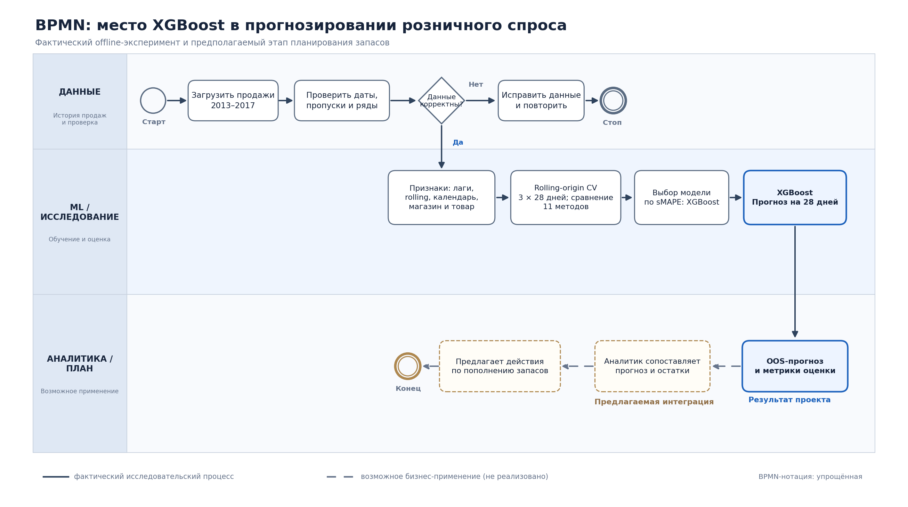

# Место модели XGBoost в процессе прогнозирования спроса (BPMN)

## 1. Схема процесса

## 2. Какую задачу решает модель

XGBoost прогнозирует **ежедневное количество продаж на следующие 28 дней** для каждого сочетания из **10 магазинов и 50 товаров**. Это задача **регрессии временных рядов**, а не классификации. Модель занимает место между подготовкой данных/признаков и выдачей числового прогноза; на этапе исследования её качество сравнивается с другими статистическими, ML- и DL-методами.

## 3. Почему целесообразен Machine Learning

Данные содержат 500 рядов, различающихся по масштабу и динамике. При этом выявлены календарная сезонность и зависимость продаж от предыдущих значений. Одна глобальная модель XGBoost использует признаки нескольких рядов и нелинейные зависимости между лагами, скользящими статистиками, календарём и идентификаторами. Выбор подтверждён экспериментально: в текущей схеме rolling-origin backtesting **XGBoost имеет sMAPE 12,975%**, а лучшая статистическая модель AutoETS — 16,978%. Это обоснование выбора **в данном проекте**, а не утверждение, что ML всегда лучше простого прогноза.

## 4. Что поступает на вход модели

**Исходный источник:** CSV с полями `date`, `store`, `item`, `sales` за 2013–2017 годы (913 000 записей). Данные проверяются и приводятся к формату `unique_id`, `ds`, `y`, `store`, `item`.

**Признаки XGBoost:** исторические лаги продаж 1/7/14/28 дней, rolling-статистики, день недели, месяц, идентификаторы магазина и товара. Используется масштабирование целевой переменной внутри ряда. Все исторические признаки вычисляются относительно доступного прошлого; реальные продажи будущих дат **не** должны использоваться при получении прогноза.

## 5. Что выдаёт модель и как используется результат

Результат — числовая оценка будущих продаж по датам и парам «магазин — товар» на горизонте 28 дней. В исследовании прогнозы используются для **out-of-sample сравнения моделей** (3 неперекрывающихся окна × 28 дней × 500 рядов = 42 000 прогнозных точек на модель) и построения выводов о качестве прогноза.

**Предлагаемый бизнес-шаг, не реализованный автоматически:** аналитик сопоставляет прогноз с текущими остатками, сроком поставки, плановыми акциями и ограничениями бюджета, после чего предлагает объёмы пополнения. Сам XGBoost не рассчитывает страховой запас, не формирует заказы и не принимает решение о закупке.

## 6. Граница ответственности этапов

| Этап | Вход | Действие | Выход / ответственность |
|---|---|---|---|
| Подготовка данных | Исторические продажи | Проверить корректность дат, пропусков и рядов | Проверенный временной набор |
| Инженерия признаков | Проверенный набор | Рассчитать лаги, rolling и календарь без утечки будущего | Матрица признаков |
| ML-исследование | Матрица признаков и истинные `y` | Сравнить модели на общих temporal CV-окнах | Метрики sMAPE/MAE/RMSE; выбор XGBoost |
| **XGBoost** | Доступная история + признаки | **Рассчитать 28-дневные прогнозы продаж** | **Прогноз по магазину, товару и дате** |
| Аналитика и запасы (план) | Прогноз + внешние бизнес-данные | Оценить риск дефицита/излишка; обсудить пополнение | Рекомендации человеку, не автоматический заказ |

## 7. Контроль и ограничения

- Для текущей модели опубликованы агрегированные **sMAPE = 12.975%, MAE = 6.168, RMSE = 8.101**; качество на новых данных и по отдельным товарам/магазинам требует проверки.
- Текущий backtesting использует 3 окна с горизонтом и шагом 28 дней, `refit=False`. На схеме это **оценка**, а не доказательство развёртывания в production.
- У прогнозов есть ошибка; для реальных запасов необходимы актуальные данные, business rules, человеческая проверка и отдельное тестирование интеграции.
