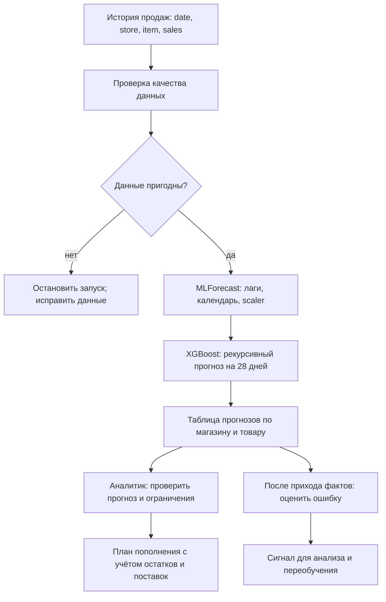

# Место модели в процессе прогнозирования продаж

Схема выполнена в Mermaid, что допускается условием ДЗ. Это схема процесса с ветвлением, а не исполняемый BPMN 2.0 XML.

## Задача модели и смысл ML

XGBoost прогнозирует **число продаж**, а не оптимальный заказ. Модель занимает место между подготовкой истории и получением будущих значений. Она использует нелинейные связи между лагами, календарём и идентификаторами, а одна глобальная модель может обучаться на многих рядах.

В исходном сравнительном исследовании XGBoost выбран по наименьшей опубликованной sMAPE 12.975%. Это историческое обоснование выбора; новый код требует пересчёта. Полезность ML в конкретном запуске проверяется сравнением с простым SeasonalNaive на одинаковых датах. Преимущество ML не предполагается заранее.

## Вход и выход

| Шаг | Вход | Действие | Результат |
|---|---|---|---|
| Источник | Исторический `train.csv` | Получить наблюдения продаж | `date,store,item,sales` |
| Data QA | CSV | Проверить типы, пропуски, дубли, даты, отрицательные/бесконечные значения, регулярность рядов | Подготовленная панель `unique_id,ds,y,store,item` или ошибка |
| Признаки | Панель до cutoff | Лаги 1/7/14/28, rolling means, dayofweek/month, store/item, LocalStandardScaler | Матрица признаков и состояние временных рядов |
| Модель | История и доступный календарь | Рекурсивный 28-дневный прогноз без реальных будущих продаж | Неокруглённые прогнозы в единицах товара |
| Выходной контракт | Прогноз | Обратное масштабирование; окончательное ограничение снизу нулём; проверка полноты | `unique_id,ds,store,item,forecast` |
| Аналитик / запасы | Прогноз + остатки, поставки, бюджет | Оценить риск дефицита/излишка и предложить пополнение | Решение человека |
| Мониторинг | Сохранённый прогноз + наступившие факты | Рассчитать sMAPE, MAE, RMSE по тем же датам и сегментам | Отчёт и возможный триггер переобучения |

## Что реализовано

В пакете реализованы проверка данных, признаки, backtest, обучение/сохранение, загрузка и пакетный прогноз. Конкретные команды: `retail-forecast evaluate`, `train`, `predict`.

Бизнес-обработка запасов, живой источник продаж и эксплуатационный мониторинг на схеме — **проектируемые интеграции**. `evaluate` уже рассчитывает offline-метрики; это не постоянно работающий мониторинг. `train` сохраняет версию, но не переключает production-модель.

Для исторического набора из 500 рядов оценка даёт 42 000 точек на модель; прогноз после обучения на всей истории — 14 000 строк (500 × 28). При данных до 31.12.2017 это прогноз на январь 2018 года. Качество на современных данных требует отдельной проверки.
