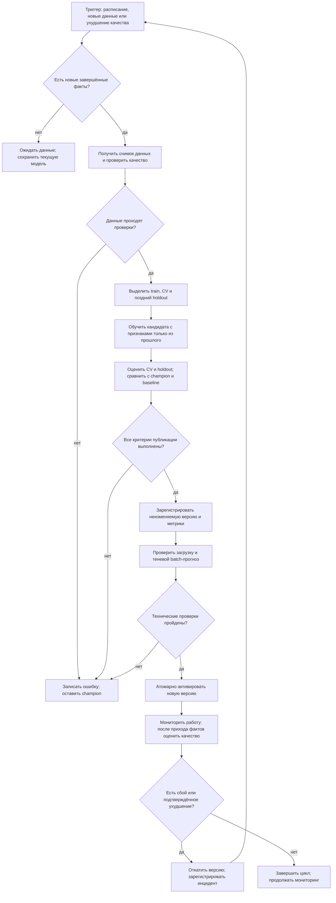

# Процесс автоматического переобучения модели

**Статус:** целевой процесс (To-Be) для ДЗ №3. Пакет уже предоставляет проверку данных, временную оценку, обучение/сохранение и инференс. Планировщик, независимый release-gate, registry активных моделей, мониторинг и откат пока не подключены. Наличие схемы не означает работающей production-автоматизации.

## Схема

Схема процесса создана в Markdown/Mermaid, как разрешено заданием; это не исполняемый BPMN-файл.

## 1. Что запускает переобучение

- **Расписание:** например, каждые 28 дней после закрытия очередного блока продаж.
- **Новые данные:** появились новые полные дни по ожидаемым магазинам и товарам.
- **Падение качества:** по завершённым прогнозным периодам метрика нарушает заранее согласованный предел в нескольких последовательных проверках.
- **Дрейф:** изменение распределений вызывает проверку/заявку, а не автоматическую публикацию само по себе.
- **Ручной запуск:** инженер исправил данные или модель; фиксируется причина.

Проверка полного 28-дневного прогноза возможна только после поступления всех 28 дней фактов. Частичные факты не используются как полная оценка. Должен быть один активный процесс на версию данных; повторный сигнал с тем же hash не создаёт дубликат.

Исходные данные заканчиваются в 2017 году, поэтому для реального расписания нужен актуальный источник. До этого процесс демонстрируется на последовательных исторических срезах, без заявления о живом обновлении.

## 2. Этапы, действия и передаваемые результаты

| Этап | Что происходит | Результат следующему шагу |
|---|---|---|
| Триггер | Проверить причину и новые завершённые факты; установить блокировку запуска | `run_id`, причина, дата доступности данных |
| Получение данных | Снять неизменяемый snapshot продаж | Версия данных, hash, cutoff |
| Проверка данных | Типы, NaN/inf, неотрицательность, дубли, ежедневная сетка, ожидаемый состав рядов; аномалии исследовать | QA-отчёт и PASS либо DATA_REJECTED |
| Временное разделение | Отделить поздний holdout; определить обучающие срезы и три CV-окна по 28 дней | Даты разделов, train/CV/holdout без пересечения обучения и будущего |
| Признаки / обучение | На каждом обучающем срезе отдельно построить scaler и признаки; обучить XGBoost | Кандидат, конфигурация, версии кода и окружения |
| Проверка качества | На CV изучить устойчивость; на независимом holdout сравнить кандидата, champion и SeasonalNaive | Метрики общей ошибки и сегментов, таблица сравнений |
| Решение | Применить зафиксированный заранее quality gate | PASS/REJECT с причинами |
| Регистрация | Сохранить модель вместе со scaler, состоянием рядов, датами обучения и отчётом | Неизменяемая версия с lineage и предыдущей активной версией |
| Тестовый выпуск | Загрузить артефакт в среде сервинга, получить теневой прогноз | Отчёт по формату, полноте, NaN/inf, времени и памяти |
| Деплой | Атомарно переключить указатель активной версии, не удаляя предыдущую | Новая активная версия и журнал активации |
| Мониторинг / откат | Проверять batch сразу; оценивать прогноз по мере появления фактов; при сбое вернуть предыдущую версию | Рабочий прогноз либо rollback + инцидент |

**Порядок обучения и оценки:** нельзя сначала обучить модель на всём снимке, а потом выдавать её качество на части этого снимка за out-of-sample. Для каждого CV-среза используются только более ранние факты. Holdout отделяется до выбора/подстройки; кандидат для gate обучается только до начала holdout.

Для целевого процесса допускается `refit=True` на CV, в отличие от исторического исследовательского `refit=False`. Политику фиксируют в конфигурации и одинаково применяют при сравнениях; исторические числа при этом не переносятся.

## 3. Условия публикации

Ниже **пример предлагаемой политики**, а не согласованный с реальным заказчиком SLA и не реализованный автоматически gate:

1. `sMAPE_candidate <= 0.98 * sMAPE_champion` на общем независимом holdout: улучшение минимум на 2% относительно.
2. `MAE_candidate <= 1.05 * MAE_champion` и `RMSE_candidate <= 1.05 * RMSE_champion`.
3. `sMAPE_candidate < sMAPE_SeasonalNaive` на тех же датах.
4. По каждому заранее определённому сегменту `store` и `item`: рост sMAPE не более **2 процентных пунктов** относительно champion; список сегментов и правило задаются до оценки.
5. Все обязательные проверки данных, временной причинности, сериализации, формата и ресурсов пройдены.

Порог 12.975% из прошлого исследования не используется как постоянный gate для новых данных. Процентные пункты в сегментном правиле отличаются от относительных процентов в пункте 1.

**Честный champion:** предпочтительно сравнивать с прогнозами активной модели, сохранёнными до появления фактов. Нельзя оценивать старую модель на периоде, уже входившем в её обучение. При отсутствии сопоставимого прогноза champion или полного holdout автоматическая публикация запрещена: статус WAITING_FOR_EVALUATION.

**Первая версия:** если champion ещё нет, проходит отдельную начальную проверку против baseline и бизнес-порогов, затем ручное утверждение. Успешное выполнение `train` этого решения не заменяет.

**Артефакт после gate:** автоматически публикуется именно проверенная версия. Если после gate дополнительно переобучать её на train + holdout, получится другой артефакт; его нельзя молча считать прошедшим тот же тест. Для такого refit нужен отдельно утверждённый протокол, повторные технические проверки и shadow/проверка на следующем честном периоде. Базовый вариант этой схемы сохраняет проверенный артефакт; новые факты для лагов добавляются отдельным проверенным механизмом обновления состояния перед прогнозом.

## 4. Что делать при ошибках

| Ситуация | Реакция | Рабочая модель |
|---|---|---|
| Нет новых фактов | WAITING_FOR_DATA, завершить цикл без обучения | Сохраняется |
| Нарушен контракт данных | DATA_REJECTED, отчёт и уведомление ответственного | Сохраняется |
| Ошибка обучения / нехватка памяти | FAILED, лог; ограниченный retry только технических ошибок | Сохраняется |
| Кандидат хуже или gate неполон | REJECTED, сохранить метрики и причины | Сохраняется |
| Артефакт не загружается / неверный shadow-прогноз | Не активировать; сохранить отчёт | Сохраняется |
| Сбой после активации | Вернуть предыдущий указатель, подтвердить работоспособность | Предыдущая проверенная |
| Ухудшение по наступившим фактам | Разбор, предусмотренный политикой rollback; новый цикл | Последняя пригодная версия |

При откате нужно не только вернуть веса, но и восстановить совместимое состояние истории/признаков до актуального cutoff. Если прежний артефакт отстаёт по датам, сначала обновить его доступными фактами либо использовать заранее проверенный fallback; выдавать устаревший прогноз как текущий нельзя.

## 5. Артефакты и соответствие коду

Для автоматизированного цикла сохраняются: snapshot/hash, data QA report, схема признаков, параметры, артефакт модели+preprocessing+состояние, CV и holdout-прогнозы, метрики, решение gate, shadow-отчёт, журнал активации и ссылка на предыдущую версию.

Уже реализовано:

- `data/validation.py` — базовая проверка входа;
- `retail-forecast evaluate` — temporal CV и baseline, сегментные метрики, hashes;
- `retail-forecast train` — новая неперезаписываемая папка модели и metadata;
- `retail-forecast predict` — загрузка, проверка hashes, полный batch-прогноз;
- pytest и GitHub CI — проверки корректности кода, а не качества на новых продажах.

Нужно реализовать при переходе к эксплуатации: источник новых данных, scheduler/concurrency, отдельный holdout и champion gate, registry/active pointer, обновление истории активной модели, shadow, мониторинг и откат. Сам запуск CI или сохранение папки `artifacts/` не является production-деплоем.
