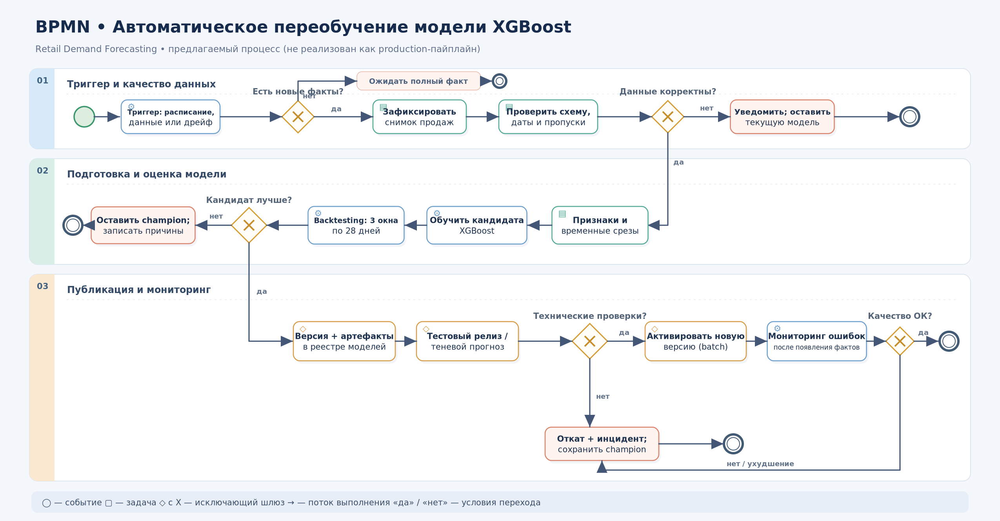

# BPMN: процесс автоматического переобучения XGBoost

## 1. Диаграмма процесса



### Краткая логика

1. Проверяем, возник ли повод для переобучения и есть ли новые **завершённые** фактические продажи.
2. Загружаем новые данные и валидируем их; при ошибках **останавливаем запуск без замены текущей модели**.
3. Формируем признаки, корректные временные срезы и обучаем кандидата XGBoost.
4. Проводим *rolling-origin backtesting* и независимую проверку кандидата; сравниваем с текущей рабочей моделью (**champion**) и простым сезонным прогнозом.
5. Только если кандидат удовлетворяет заранее зафиксированным критериям, версионируем его, проверяем тестовый релиз и активируем для пакетного прогнозирования.
6. После выхода фактических продаж мониторим качество; при провале технических/качественных проверок откатываемся к предыдущей исправной версии и фиксируем инцидент.

## 2. Почему в этом проекте нужно переобучение

Модель предсказывает количество продаж `sales` (`y`) на следующие 28 дней для каждой пары `store`–`item`. В проекте используются календарные признаки, лаги продаж и скользящие статистики; зависимости могут изменяться из-за сезонности, ассортимента и структуры спроса. Поэтому модель, обученная только на историческом периоде, со временем может терять качество.

В исходном датасете **2013–2017 годы** (913 000 строк). Автоматическое переобучение имеет смысл **только после подключения актуального источника новых наблюдений**. Пока такого источника нет, процесс может быть воспроизведён как *демонстрационный* на последовательных исторических отсечках, но нельзя заявлять, что модель регулярно обновляется по живым данным.

Ранее в проекте для сравнения моделей использовались **3 окна по 28 дней с шагом 28 дней**; текущий результат XGBoost — **sMAPE 12,975%, MAE 6,168, RMSE 8,101**. Это **исторические offline-метрики**, а не условия или доказательства успешного будущего развёртывания. В предложенном процессе параметры backtesting сохраняются как основа, но **обучение новой версии, в отличие от эксперимента с `refit=False`, выполняется заново**.

## 3. Триггеры запуска переобучения

| Триггер | Условие | Реакция |
|---|---|---|
| **Плановый** | Например, раз в 28 дней после поступления очередного полного блока фактических продаж | Запустить проверку доступности данных и при достаточной полноте переобучить модель |
| **Поступление данных** | Появилось достаточно новых валидных ежедневных наблюдений, отсутствовавших в снимке прошлого обучения | Запустить подготовку новой версии данных |
| **Падение качества** | По закрытым прогнозным периодам обнаружено устойчивое ухудшение sMAPE/MAE/RMSE относительно согласованного SLA | Сформировать внеплановую заявку на переобучение; выполнить ту же проверку данных |
| **Дрейф данных** | Существенно изменились распределения или доли пропусков/нулевых продаж | Создать сигнал для анализа и проверки; **сам по себе дрейф не означает автоматическую публикацию** |
| **Ручной** | ML-инженер инициирует запуск после исправления данных, смены схемы или бизнес-изменений | Запуск с указанием причины и номера версии |

**Условия для всех триггеров:** только один активный запуск на один набор/версию данных; повторный идентичный сигнал не создаёт дубликат; нужны доступные истинные значения для оценки качества. Для оценки полного горизонта 28 дней факты должны поступить *после* даты, когда прогноз был сделан: преждевременная оценка недопустима. При отсутствии полного набора фактов запуск заканчивается ожиданием, текущая модель остаётся активной.

## 4. Карты этапов — что происходит и что передаётся дальше

| № | Этап / исполнитель (To-Be) | Что происходит | Выход следующему этапу |
|---:|---|---|---|
| 1 | **Триггер** / планировщик и мониторинг | Проверить расписание, наличие новых данных, просадку качества или дрейф; защититься от дублирующих запусков | `run_id`, причина запуска, максимальная доступная дата |
| 2 | **Проверка наличия фактов** / оркестратор | Убедиться, что есть новый завершённый временной период с целевыми значениями `sales` | Разрешение на загрузку; иначе статус `WAITING_FOR_DATA` |
| 3 | **Загрузка и снимок данных** / data pipeline | Прочитать обновлённые `date`, `store`, `item`, `sales`, сохранить неизменяемый снимок и метаданные источника | `dataset_version`, снимок продаж, временная граница `data_cutoff` |
| 4 | **Валидация данных** / data QA | Проверить типы, даты, отсутствие дублей `(date, store, item)`, неотрицательность продаж, непрерывность дат, покрытие ожидаемых рядов, выбросы/пропуски. Аномалии расследовать, а не удалять без правил | `data_quality_report`; при провале — `DATA_REJECTED` и уведомление, без обновления модели |
| 5 | **Подготовка признаков** / feature pipeline | Получить `unique_id`, `ds`, `y`; воспроизводимо рассчитать лаги (1/7/14/28), rolling-статистики и календарные признаки. Формировать историю **только до соответствующего cutoff** | Подготовленные обучающие/валидационные окна, схема признаков и версия preprocessing |
| 6 | **Обучение кандидата** / ML training | Обучить новую XGBoost на новом доступном обучающем периоде; зафиксировать конфигурацию, random seed, версии библиотек и исходный commit | Кандидат `model_candidate`, его метаданные и артефакт |
| 7 | **Проверка качества** / evaluation | Rolling-origin backtesting: 3 последовательные временные отсечки, горизонт 28 дней и шаг 28 дней; вычислить sMAPE/MAE/RMSE, метрики по магазинам/товарам, сравнить с SeasonalNaive. Дополнительно оценить на **неиспользованном при подборе** позднем holdout | `evaluation_report` и решение `PASS` / `REJECT` |
| 8 | **Решение о публикации** / quality gate | Сопоставить кандидата с `champion` **на одинаковом честном временном периоде**, проверить бюджет ошибок, утечки и работоспособность прогнозирования | `promotion_decision`; при `REJECT` остаётся предыдущая версия, формируется отчёт |
| 9 | **Регистрация** / model registry | Сохранить файл модели, параметры, код/конфигурацию, hash данных, метрики и связь с предыдущей версией | Неизменяемая версия `candidate_version`, доступная для отката |
| 10 | **Тестовый выпуск** / release pipeline | Сгенерировать теневой пакетный прогноз (не заменяя рабочий), проверить формат и полноту 28-дневного результата, число рядов, отсутствие NaN/inf и существенных ресурсных сбоев | `smoke_test_report`, статус canary/shadow |
| 11 | **Активация** / batch serving | Атомарно переключить указатель активной модели на новую версию после успешных проверок; вести журнал публикации | `active_model_version`, новые прогнозы по датам и товарам |
| 12 | **Мониторинг и откат** / operations | Проверять целостность ежедневного batch-запуска, изменения признаков, а **когда доступны реальные продажи** — качество по горизонту и сегментам. При ухудшении — переключить указатель обратно и известить ответственного | Отчёт мониторинга, `ROLLED_BACK` или завершение успешного цикла |

### Какие проверки запрещают публикацию

- Недостаточно данных или не пройдены проверки целостности: ошибки схемы, дубли, некорректные даты, недопустимые значения, необъяснённые пропуски.
- Нарушена **временная причинность**: например, лаг для прогнозируемой даты подсчитан из реально наблюдённых продаж после `cutoff`. Особенно важно на горизонте 28 дней, когда будущие лаги должны строиться без подглядывания в факты.
- Нет честного out-of-time теста или сопоставимого сравнения с предыдущей моделью; использован случайный train/test split либо тест многократно применялся при подборе гиперпараметров.
- Кандидат не улучшает ключевые метрики, существенно ухудшает отдельные товары/магазины или уступает простому сезонному baseline.
- Артефакт не загрузился, формат прогноза неправильный, модель не проходит smoke-тест или превышает ресурсные лимиты.

## 5. Правило принятия решения: публиковать или нет

**Основная метрика:** sMAPE, **меньше — лучше**. Дополнительные защитные: MAE, RMSE и стабильность по `store`/`item`.

**Иллюстративные пороги для учебной схемы** (это *предлагаемая политика*, она **не настроена и не проверена экспериментально** в репозитории):

1. На общем независимом временном holdout новая модель должна уменьшать sMAPE **не менее чем на 2% относительно ошибки текущей**: `sMAPE_candidate <= 0.98 * sMAPE_champion`.
2. `MAE_candidate <= 1.05 * MAE_champion` и `RMSE_candidate <= 1.05 * RMSE_champion`, чтобы избежать значительного ухудшения больших ошибок.
3. `sMAPE_candidate < sMAPE_SeasonalNaive`, рассчитанной на том же периоде.
4. Не должно быть критического ухудшения в заранее определённых группах магазинов/товаров; порог на уровне сегментов требуется утвердить с бизнес-заказчиком.
5. Все проверки качества данных, защиты от утечек, схемы признаков и smoke-тесты обязательны независимо от выигрыша в sMAPE.

**Важное уточнение:** для сравнения с `champion` нельзя оценивать старую модель на историческом окне, данные которого уже входили в её обучение. Корректный вариант — заранее записывать прогнозы активной модели и после прихода фактов считать ошибки за одни и те же новые даты; кандидат обучать лишь на данных до соответствующего контрольного среза. Для будущих циклов использовать отдельное честное позднее контрольное окно, не участвовавшее в подборе. Если сопоставимых прогнозов и завершённых фактов пока нет, **новую версию не публиковать автоматически**.

В первом цикле, если production-версии ещё нет, необходимо вручную подтвердить *исходную (initial champion)* после отдельного аудита и тестового запуска. Историческое значение **12,975%** не является постоянной границей качества для новых лет и не заменяет оценку на актуальных данных.

## 6. Обработка ошибок и откат

| Сбой / условие | Реакция системы | Что остаётся доступно |
|---|---|---|
| Недоступен источник, новых фактов нет | Не обучать; пометить цикл `WAITING_FOR_DATA` | Текущая модель и последний успешный прогноз |
| Провал проверки качества данных | Сохранить отчёт об ошибках; уведомить; завершить `DATA_REJECTED` | Текущая версия без изменений |
| Ошибка feature pipeline / обучения / нехватка памяти | Зафиксировать `run_id`, stack trace и входную версию; ограниченно повторить технический шаг, затем `FAILED` | Текущая версия без изменений |
| Новая модель не прошла тесты | `REJECTED`, сохранить метрики и причины для анализа | Текущая версия без изменений |
| Неуспешный shadow/canary | Не переключать активную версию; откатить тестовый выпуск | Предыдущий рабочий прогнозный процесс |
| Ошибка в эксплуатации либо подтверждённое снижение качества после поступления фактов | Вернуть указатель на предыдущую проверенную версию, зарегистрировать инцидент, назначить разбор | Последняя проверенная версия (`last-known-good`) |

**Правило безопасности:** переобучение ≠ автоматическая публикация. Любая неуспешная обязательная проверка приводит к **сохранению текущей модели**, а не к замене на непроверенную.

## 7. Минимальные артефакты каждого запуска

```text
artifacts/
└── runs/<run_id>/
    ├── data_manifest.json        # версия/период/хэш снимка данных
    ├── data_quality_report.json  # полнота, дубли, аномалии
    ├── feature_schema.json       # перечень, типы и версии признаков
    ├── model_candidate.*         # сериализованная модель и препроцессинг
    ├── backtest_metrics.csv      # окна, магазины, товары, sMAPE/MAE/RMSE
    ├── holdout_comparison.json   # кандидат vs champion vs baseline
    ├── promotion_decision.json   # условия и причина PASS/REJECT
    ├── smoke_test_report.json    # тест прогнозирования перед публикацией
    └── lineage.json              # commit, версии пакетов, предыдущая версия
```

Это **предлагаемая структура будущего артефактного хранилища**. Версии не нужно перезаписывать: старый артефакт необходим для восстановления.

## 8. Как реализовать это в проекте

| Компонент | Возможная реализация | Для чего |
|---|---|---|
| Планировщик | GitHub Actions schedule, Airflow или Prefect | Плановые и ручные запуски, блокировка дублей |
| Инкрементальная загрузка | Скрипт загрузки CSV/таблицы продаж | Получение новых дат, snapshot и контроль полноты |
| Data QA | Python/pandas + тесты, при необходимости Great Expectations | Валидация структуры и значений |
| Переобучение | Выделенный Python-скрипт с переиспользованием feature engineering из проекта | Reproducible обучение XGBoost |
| Валидация и gate | Backtesting, метрики sMAPE/MAE/RMSE, сравнение champion/challenger | Безопасный выбор версии |
| Версии и метаданные | MLflow или файлы с manifest + объектное хранилище | Audit trail и восстановление |
| Batch-развёртывание | Версионированный файл модели и атомарное обновление активной версии | Отложенное пакетное прогнозирование на 28 дней |
| Мониторинг | Плановый расчёт ошибки по мере прихода фактов, алерты | Отслеживание качества и безопасный откат |

**Дополнительное ограничение:** исходный Kaggle-набор не содержит остатков, закупок или событий бизнес-системы. Поэтому переобучение модели прогнозирования продаж **не означает** автоматическое формирование заказов поставщикам. Это отдельный бизнес-процесс.
